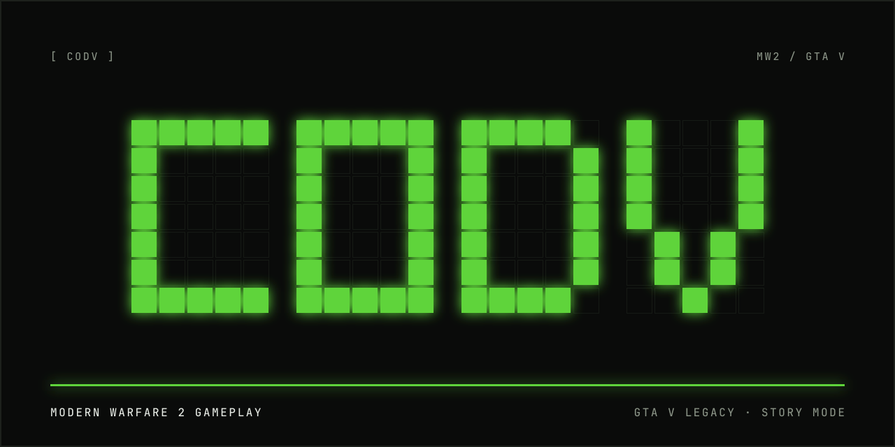
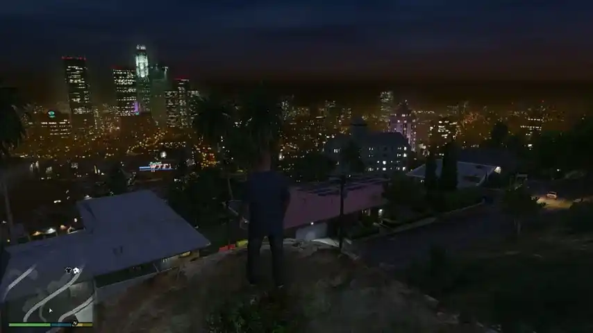

# CODV

> **Unofficial fan project.** CODV is not affiliated with, endorsed by or sponsored by Activision, Infinity
> Ward, Rockstar Games or Take-Two Interactive. It contains no Call of Duty or GTA V code, data, models,
> animation, sound or art: you need your own copies of GTA V Legacy and Call of Duty: Modern Warfare 2 (2009,
> PC), and the setup reads MW2's files on your machine only. Story Mode only; never use it online.

Modern Warfare 2 gameplay in **GTA V Legacy** Story Mode, through ScriptHookV. Switch CODV on and you play as an
MW2 soldier in Los Santos: MW2's own movement (sprint, slide, mantle, prone), its weapons with their real fire
rates, spread, kick and reloads, its first-person view models, sounds and HUD, and all ten of its killstreaks,
from the UAV to the Tactical Nuke. GTA keeps the world: its traffic, police, vehicles and everything else.

CODV is built the way SK8V brings Skate 3 to GTA: Modern Warfare 2's own engine code, from
[iw4L](https://github.com/vladtrc/iw4L) (Apache-2.0), runs inside the mod, with GTA as the world. What is in
each phase: docs/ROADMAP.md. What changed in each release: CHANGELOG.md.

## Requirements

- **Windows x64** and **GTA V Legacy 1.0.3889.0**, Story Mode, BattlEye off. GTA V Enhanced, GTA Online and FiveM
  are not supported.
- [ScriptHookV](https://www.dev-c.com/gtav/scripthookv/) **v3889.0 / 1158.13** with its ASI loader, in the GTA folder.
- Your own **Call of Duty: Modern Warfare 2 (2009, PC)** installed: setup imports its weapons, view models,
  animation, sounds and HUD from your copy (without it, CODV runs its interim gunplay only).
- About **300 MB** free on the GTA drive for the imported MW2 data.

## Install

1. Download and extract the latest **CODV release ZIP** from [Releases](../../releases/latest), **not** GitHub's
   "Source code" ZIP.
2. Close GTA V and run **`CODV Setup.cmd`**.
3. Check the **GTA V Legacy** and **Modern Warfare 2** folders (setup finds them on Steam, the Rockstar Games
   Launcher or Epic when it can) and press **Install**. If the GTA folder is protected (Program Files and
   similar), setup offers to restart as administrator; if it stops, pressing Install again picks up where it left
   off. Setup downloads a private Python (about 11 MB, python.org) only if your PC has none.
4. Start GTA V Legacy Story Mode with BattlEye off and pick **MW2** in the weapon wheel (or press F10).

Setup writes `CodVLegacy.asi`, `CodVRuntime.dll`, `CodVHost.ini` and `CodVLegacy.ini` next to `GTA5.exe`, CODV's
weapon wheel item under `update\x64\dlcpacks\codv\`, and the imported MW2 data into `CODV\`. Nothing of GTA's
own files is modified.

From source (Windows): `INSTALL.bat` builds and installs, finding GTA V and MW2 the same way (or
`INSTALL.bat "<GTA V folder>" -Mw2 "<MW2 folder>"`). See BUILDING.md.

## Playing

CODV loads with the game but starts **off**. Open GTA's weapon wheel and pick **MW2** (next to fists, with a rifle
icon), or press **F10** (keyboard) or **Back + RB** (controller), to switch it on. F10 / Back + RB again (or the
menu) hands everything back to GTA. Each switch-on brings new random MW2 guns (below).

| | Keyboard and mouse | Controller |
|---|---|---|
| Fire | Left mouse | RT |
| Aim down sights | Right mouse | LT |
| Sprint | Shift | A |
| Reload | R | B |
| Next weapon | Tab or mouse wheel | LB |
| Knife | F | R3 |
| Crouch (tap) / prone (hold) | Ctrl | L3 |
| Slide (while sprinting) / dive (hold through the slide) | Ctrl | L3 |
| Jump / mantle / climb a tall ledge (at a wall) | Space | X |
| Frag grenade (hold to cook, release to throw) | G | RB |
| Weapon groups: primaries / secondaries / snipers / launchers (again: the group's next gun) | 1 / 2 / 3 / 5 | |
| Killstreak | 4 | D-pad right |
| Lean left / right (hold) | Q / E | |
| Take a ladder | walk into it | Y |
| Third-person camera (`ThirdPersonKey=1`; off by default) | C | Back |
| CODV menu | + (or numpad +; `MenuKey`) | Back + LB |

These are GTA's own control actions, so your GTA key bindings carry over. While CODV drives you, F is only the
knife: switch the mode off to get into a vehicle (on a controller, Y still enters the vehicle you look at, and you
can shoot from the seat with MW2's HUD and gun).

## Features

**Movement.** MW2's own movement through Los Santos, against GTA's collision, cars, props and people, with
CODV's additions (each one a menu setting): a slide when you crouch while sprinting (hold crouch to dive and
land prone), a sprint meter, landings that keep your speed, an auto vault over low ledges (a car, a wall up to
1.5 m) without stopping, a climb up ledges of 1.5 to 2.4 m, a reload that carries on while you sprint (a little slower), lighter fall damage than MW2's and a lean around
corners. Ladders and parachutes are GTA's, with MW2's view and HUD kept. Footsteps and landings are MW2's,
chosen by the ground's material.

**Weapons.** MW2's multiplayer weapons, imported from your copy, fire, aim, spread, kick, reload and swap with
MW2's own numbers, and hits do MW2's damage with its range falloff and hit locations. Each switch-on puts three
different random guns behind each number key (`WeaponSets`): key 1 primaries (assault rifles, SMGs, LMGs), key 2
secondaries (shotguns, machine pistols, handguns), key 3 sniper rifles, key 5 launchers (RPG-7, AT4, Stinger,
Javelin, Thumper). Every gun keeps its own rounds; MW2's Scavenger gives a magazine for each gun and a frag on
every hostile kill. The Stinger locks on to aircraft (up to 2500 m) and the Javelin to ground vehicles (it climbs
over its target and dives on top); a locked missile flies about 3 km and goes off near its target, so aircraft
crossing the sky come down (`Mw2Missiles`). The RPG-7, the AT4 and the Thumper fire straight.

**View, body and sound.** MW2's first-person arms and guns, animated by MW2's own animation code (raise, fire,
aim, reload, sprint, melee, with MW2's bob, sway and kick). In third person your GTA character keeps its look
and moves with MW2's animations. Weapon sounds are MW2's, played inside GTA's own audio, so GTA's volume
settings and pause apply.

**HUD.** MW2's compass, crosshair, sniper scopes and the Javelin's CLU view, the weapon bar with rounds, spare
ammo and frags, the hit marker, damage direction arrows, the grenade indicator, the yellow "+100" kill feedback
and bonus splashes, MW2's blood as your health drops, and MW2's score bar with your kills and deaths.

**Killstreaks.** Kill hostile people in a row (police, military, anyone fighting you; civilians neither count
nor reset the streak) and MW2's killstreaks come in with MW2's splash and announcer. Press 4 (D-pad right) to call
in the top one. All ten are in play by default, one per kill count in one life:

| Kills | Reward |
|---|---|
| 3 | **UAV**: hostile people on the radar for 30 s |
| 6 | **Care Package**: a crate dropped on a flare where you aim; hold E at it for a killstreak or ammo |
| 9 | **Predator Missile**: ride the missile down in MW2's thermal view |
| 12 | **Sentry Gun**: fires at hostiles for 90 s |
| 15 | **Precision Airstrike**: pick the target from above; two jets carpet it |
| 18 | **Attack Helicopter**: circles you for 60 s, firing at hostiles |
| 22 | **AC-130**: 40 s on the gunship's guns, with MW2's HUD |
| 26 | **Chopper Gunner**: 40 s on the helicopter's turret, with MW2's HUD |
| 30 | **EMP**: the city's lights out, engines dead and aircraft down near you for 60 s |
| 35 | **Tactical Nuke**: MW2's countdown and blast, then a long aftermath (orange sky, smoke, empty streets); you survive (`NukeKillsPlayer=1`: MW2's rule, it takes you too) |

The streak counts per life, and rewards you have not used are lost when you die (`KeepKillstreaksOnDeath=1`
keeps them). The Tactical Nuke ends the run: its blast's kills count, then the streak starts over from zero and the
rewards still held are cleared (nothing else can be called in while it is inbound). Each nuke also starts a new round: the score bar shows
"Round N", one more after every nuke. "Spaced kill counts" off in the menu uses MW2's own counts (UAV 3 to Nuke 25); "All killstreaks" off
uses MW2's rule of three picks (`Killstreak1..3`). Killstreaks stay off in story missions and never change your
wanted level.

**Police Juggernauts.** In Free Roam, at four stars a Juggernaut may join the police hunting you, and at five
up to three at once (one that dies may be replaced after 45 s, 1:15 or 1:45, at random; none while the stars flash): heavy armour, a heavy machine gun, much more health, no head shot kill and a slow, steady advance
(a bigger orange dot on the radar). His entrance plays as a short cinematic in three cuts and his death in slow
motion, and you cannot be hurt while they play. The menu's Game section turns them (or just the cinematics)
off, and "Test: spawn a Juggernaut" puts one in front of you, handy for recording.

**Without MW2.** When the setup finds no Modern Warfare 2, CODV runs its own interim gunplay on ten GTA weapons
(fire rates, spread, kick, reloads, regenerating health); docs/WEAPONS.md has their numbers and how to tune them.

## Settings

The in-game menu (+ or Back + LB) saves each change to `CodVLegacy.ini` at once. Its first page holds the mode
switch and six sections (right / A / Enter opens one, B / Backspace goes back):

| Section | Settings |
|---|---|
| Weapons | weapon sets, random guns, primary / secondary, Stinger / Javelin missiles, spare ammo, frags, Scavenger, number keys, recoil, shots (below), weapon volume |
| Movement | reload while sprinting, MW2 movement, mouse sensitivity, invert look, field of view, third person, sprint speed and time, jump height, MW2's jump slowdown, fall damage, smooth collision, quick jump, forced first person |
| Parkour | slide (speed, length), dive, auto vault (from what height), mantle speed, high climb (up to what height), movement sounds |
| HUD | MW2's HUD, stamina bar, crosshair, hitmarker, hit sounds, body animation, debug overlay |
| Killstreaks | killstreaks on / off, all ten or three picks, the three rewards, the EMP's kill count |
| Game | regenerating health, starting with CODV on, missions, police Juggernauts |

Pausing, a cutscene or the menu keep the rounds you carry; a new life starts with full ammo.

**Shots.** By default CODV fires its own bullets: it times every shot, picks where it lands inside the spread
cone, works out the range damage, and fires a GTA bullet along that exact line so impacts, blood, reactions and
the wanted level are GTA's. In this mode the gun in your hands does not show a muzzle flash. The other mode lets
GTA pull its own trigger at CODV's timing and aim point (GTA's flash and damage, CODV's rate, spread and recoil).

Weapons are data. Edit `<GTA>\CODV\weapons.json` (fire rate, damage and ranges, spread, recoil, reloads, handling
times, movement) and `CodVHost.ini` (melee clip, crouch clipsets, hitmarker sounds), then restart the game. A
broken weapon table is reported in `CodVRuntime.log` and the built-in copy is used. Reinstalling restores the
shipped table.

## Logs

`%LOCALAPPDATA%\CodV\CodVLegacy.log` (host) and `CodVRuntime.log` (gunplay core; state changes with
VerboseLog=1). The previous session's are kept as `*.prev.log`. The **Debug overlay** shows the weapon,
magazine, state, spread, ADS and sprint values live.

## Support

CODV is free and always will be. If you enjoy it, or the development series on YouTube, you can support
PurpleDarkO on [Ko-fi](https://ko-fi.com/purpledarko). It is never required, and supporting unlocks nothing: every
feature is in the public release for everyone.

## Uninstall

With GTA V closed, remove these from its folder:

- `CodVLegacy.asi`, `CodVRuntime.dll`, `CodVHost.ini`, `CodVLegacy.ini`, `CodVLegacy.installed.json`
- `CODV\` (CODV's data and the MW2 data imported from your copy)
- `update\x64\dlcpacks\codv\` (the MW2 item in the weapon wheel)

`CodVLegacy.installed.json` lists every file setup wrote. Logs are in `%LOCALAPPDATA%\CodV` and can be deleted
separately. ScriptHookV is left untouched.

## Known limitations

- Small hitches remain in some movement cases (car corners, low fences); tuning continues.
- CODV's own missiles have no in-flight sound yet.
- The RPG-7's rocket shows on the launcher only after the setup has imported MW2 with this version.
- GTA V Enhanced, GTA Online and FiveM are not supported.
- Now and then a rifle-armed NPC (SWAT, soldiers) fires a burst at a minigun's rate and can take most of your
  health at once. This is a known GTA V bug (two of its NPC rifle fire animations have a broken fire rate),
  not CODV's; CODV does not change it.

## License

CODV's own code is [Apache-2.0](LICENSE); third-party components keep their own licenses and are credited in
[NOTICE](NOTICE). CODV is an unofficial fan project; see the notice at the top of this page.
